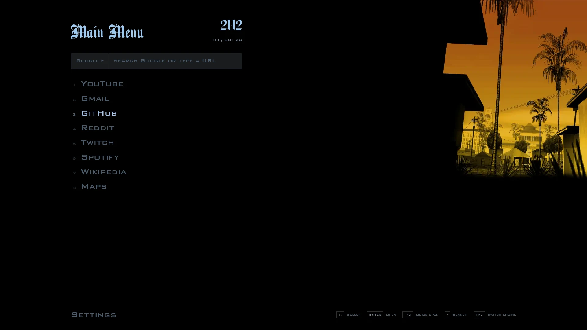
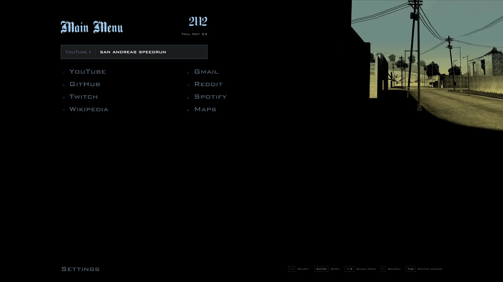
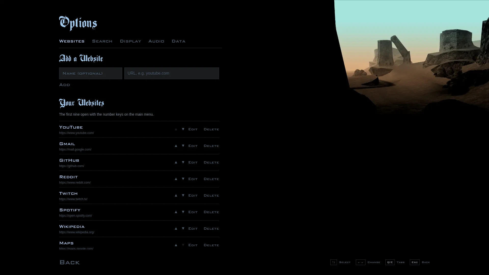
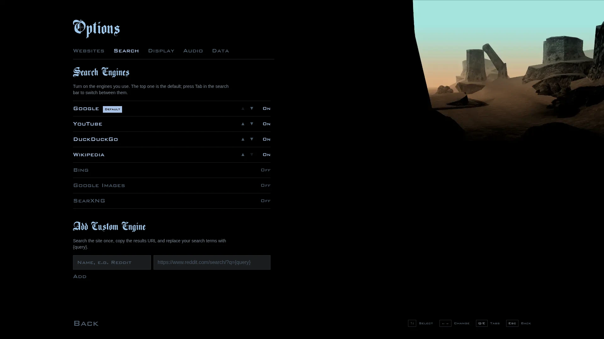
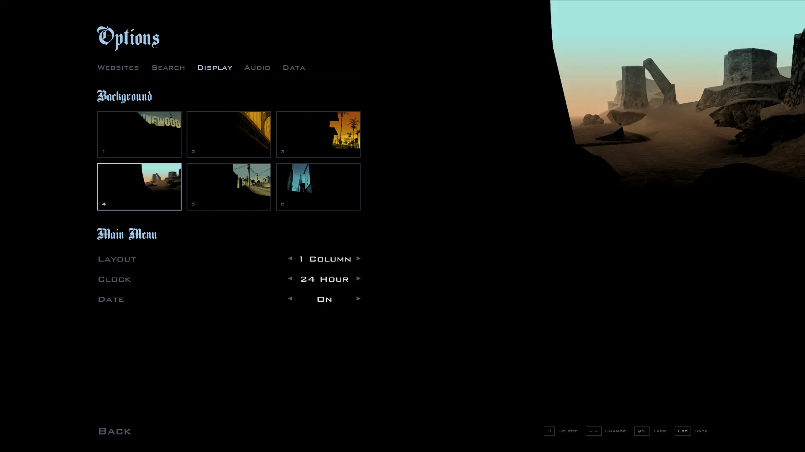
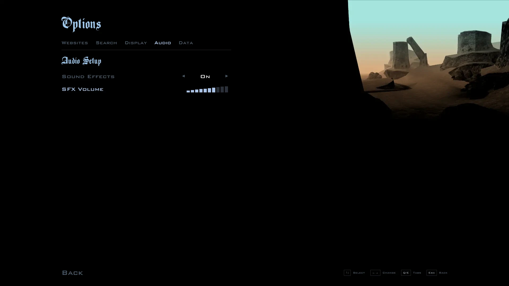
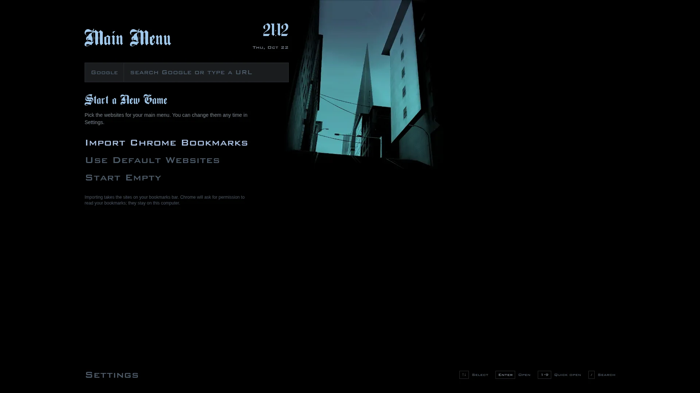

<div align="center">

# GTA San Andreas Startpage

**Your new tab, styled as the GTA San Andreas pause menu.**

Menu sounds, fonts and artwork from the game, plus a search bar, your favourite sites and keyboard controls that work like a controller.

[Live demo](https://beyondDREADFUL.github.io/gta-sa-startpage/) · [Install](#install) · [Features](#features) · [Keyboard controls](#keyboard-controls)



</div>

## Features

### Main menu

- **One search bar, many engines.** Google by default, plus DuckDuckGo, Bing, YouTube, Google Images, Wikipedia, SearXNG and any custom engine. Press <kbd>Tab</kbd> to switch engines.
- **Type a URL to go straight there.** `github.com` opens the site instead of searching for it.
- **Your websites as menu entries**, in one or two columns. <kbd>1</kbd>–<kbd>9</kbd> open them instantly, and middle-click opens a new tab.
- **Clock and date** in 24-hour or 12-hour format, or turned off.
- **Six backgrounds** from the game, plus the original menu sound effects.



### Options

Settings live on an Options screen modelled on the game's, with tabs you switch using <kbd>Q</kbd> and <kbd>E</kbd>.

| Websites | Search |
| --- | --- |
|  |  |
| Add, edit, reorder and delete websites. Paste a link and the name fills itself in. | Turn engines on and off and reorder them; the top one is the default. Add any site that has a search URL. |

| Display | Audio |
| --- | --- |
|  |  |
| Choose a background and set the layout, clock and date with <kbd>←</kbd> <kbd>→</kbd>, as in the game. | Turn sound effects on or off and set the volume on the game's segmented bar. |

The **Data** tab exports your websites and settings to a backup file and imports them again. Use it to move between computers, or between the website and the extension.

### First run

When you first install the extension, it asks how to fill your menu: import your Chrome bookmarks bar, use a few default sites, or start empty.



## Install

### Chrome extension (recommended)

The extension replaces your new tab page directly, so you don't need a "custom new tab" extension. It works in Chrome, Brave, Edge, Vivaldi and other Chromium browsers.

1. Build it:

   ```bash
   git clone https://github.com/beyondDREADFUL/gta-sa-startpage.git
   cd gta-sa-startpage
   npm install
   npm run build:extension
   ```

2. Open `chrome://extensions` and turn on **Developer mode**.
3. Click **Load unpacked** and choose the `dist-extension` folder.
4. Open a new tab.

To update later, pull the latest code, run `npm run build:extension` again and click the reload icon on the extension's card.

### Hosted page

Prefer not to install anything? Point a new tab extension at the [live demo](https://beyondDREADFUL.github.io/gta-sa-startpage/):

- **Chromium browsers:** [Custom New Tab URL](https://chrome.google.com/webstore/detail/custom-new-tab-url/mmjbdbjnoablegbkcklggeknkfcjkjia)
- **Firefox:** [Custom New Tab Page](https://addons.mozilla.org/en-US/firefox/addon/custom-new-tab-page/)

> In both versions, Chrome keeps focus in the address bar when a new tab opens. Press <kbd>/</kbd> to jump to the search bar.

## Keyboard controls

| Key | Main menu | Options |
| --- | --- | --- |
| <kbd>↑</kbd> <kbd>↓</kbd> · <kbd>J</kbd> <kbd>K</kbd> · <kbd>W</kbd> <kbd>S</kbd> | Move through the menu | Move through the options |
| <kbd>←</kbd> <kbd>→</kbd> | Move between columns | Change the selected option |
| <kbd>Enter</kbd> | Open the website | Select |
| <kbd>1</kbd>–<kbd>9</kbd> | Open that website | |
| <kbd>/</kbd> | Jump to the search bar | |
| <kbd>Tab</kbd> in the search bar | Switch search engine | |
| <kbd>Q</kbd> <kbd>E</kbd> | | Previous / next tab |
| <kbd>Esc</kbd> | Leave the search bar | Back to the main menu |

## Privacy

Everything stays in your browser: websites are stored in IndexedDB and settings in local storage. There are no accounts, analytics or network requests apart from the searches and sites you open.

The extension needs no permissions to install. It asks to read your bookmarks only if you choose to import them, and it reads only your bookmarks bar.

## Development

You'll need Node.js 18 or newer.

```bash
npm install
npm run dev
```

| Script | What it does |
| --- | --- |
| `npm run dev` | Starts the dev server with hot reload |
| `npm run build` | Builds the website into `dist/` |
| `npm run build:extension` | Builds the Chrome extension into `dist-extension/` |
| `npm run zip:extension` | Builds the extension and packages it as `gta-sa-startpage.zip` for the Chrome Web Store |
| `npm run deploy` | Builds the website and publishes it to GitHub Pages |

The app uses [Preact](https://preactjs.com/), [Vite](https://vitejs.dev/), [Tailwind CSS](https://tailwindcss.com/) and [Dexie](https://dexie.org/).

```
src/
├── app.tsx              Top-level state and routing between menus
├── components/
│   ├── Home.tsx         Main menu
│   ├── SearchBar.tsx    Search box and engine switching
│   ├── FirstRun.tsx     First-run website choice
│   ├── ui.tsx           Menu buttons, option rows, volume bar
│   └── Settings/        Options screen and its tabs
├── hooks/               Keyboard menu navigation
├── db.ts                Websites (IndexedDB)
├── settings.ts          Settings (local storage)
├── searchEngines.ts     Built-in search engines
└── bookmarks.ts         Chrome bookmarks import
extension/               Extension manifest and icons
```

## Credits

- The menu design, artwork, fonts and sounds come from *Grand Theft Auto: San Andreas* by **Rockstar Games**. This is a fan project with no affiliation to Rockstar.
- Built on [wjkba's original GTA SA menu startpage](https://github.com/wjkba/gta-sa-menu-startpage).

## License

[MIT](./LICENSE.md)
